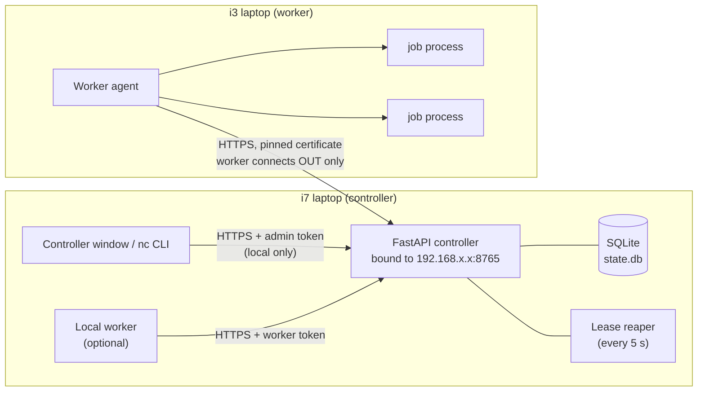

# Architecture

## Overview



The same picture as plain text:

```
 i7 (controller)                                        i3 (worker)
┌──────────────────────────────────────┐              ┌───────────────────────────────┐
│ GUI / nc ──HTTPS+admin token──┐      │              │ Worker agent                  │
│   (only from this computer)   ▼      │   HTTPS      │   heartbeat every 5 s         │
│        FastAPI controller ◄──────────┼──────────────┤   claim jobs when slots free  │
│        192.168.1.4:8765              │ worker dials │   ┌──────────┐ ┌──────────┐   │
│          │            │              │ out; nothing │   │ job proc │ │ job proc │   │
│     SQLite state   lease reaper      │ listens on i3│   │ low prio │ │ mem cap  │   │
│          ▲                           │              │   └──────────┘ └──────────┘   │
│ local worker (i7 works too)          │              │ secrets in %LOCALAPPDATA%     │
└──────────────────────────────────────┘              └───────────────────────────────┘
```

## Why "pull" instead of "push"

Workers ask the controller for work; the controller never connects to a worker. This means:

- the i3 opens **no network port**, so nothing on the network can connect to it or control it;
- only the i7 needs a firewall rule;
- a worker behind a flaky Wi-Fi link just retries, and load balances naturally: a fast machine
  finishes chunks sooner and therefore asks for more.

## Components

| Module | Role |
|---|---|
| `controller.py` | HTTPS API, `PairingManager`, `ControllerRuntime` (server thread + reaper thread) |
| `store.py` | SQLite tables `workers`, `batches`, `jobs`, `attempts`; atomic claim; lease logic |
| `worker.py` | `WorkerAgent`: heartbeat, claim, run, report, reconnect, limits, graceful stop |
| `jobrunner.py` | Child process: reads `{kind, params}` on stdin, runs `jobs.execute`, prints the result |
| `jobs.py` | The allowlist: validation, execution, splitting and combining of each job kind |
| `client.py` | Pinned-TLS HTTP clients and the worker side of the pairing handshake |
| `security.py` | Tokens, pairing codes and proofs, self-signed certificate, Windows file ACLs |
| `winlimits.py` | Windows Job Object (memory cap, kill on worker exit), low priority |
| `updater.py` | Release-tag update with self-test and rollback |
| `gui.py`, `worker_gui.py` | Tkinter windows (no extra dependency) |

## Data and secrets locations

Everything lives outside the Git checkout, in `%LOCALAPPDATA%\NetworkConnector`
(override with `NC_HOME`):

```
NetworkConnector\
  controller\  controller.json  server.crt  server.key*  admin.token*  state.db
  worker\      worker.json* (contains the token)  controller.crt (pinned)  status.json  work\
  local-worker\  same as worker\, for the i7's own worker
  logs\        controller.log  worker.log  ...
  app\         (i3 only) the Git checkout installed by setup-worker.ps1
```

Files marked `*` are secrets. Their Windows permissions are narrowed to your user account.

## Job lifecycle

```mermaid
stateDiagram-v2
    [*] --> queued: submitted
    queued --> running: claimed by a worker (attempt +1, lease starts)
    running --> succeeded: result reported
    running --> queued: retryable failure / timeout / lease expired (attempts left)
    running --> queued: worker shut down gracefully (released, attempt refunded)
    running --> failed: non-retryable error, or no attempts left
    queued --> cancelled: cancel
    running --> cancelled: cancel delivered with the next heartbeat; process killed
    failed --> queued: manual retry
    cancelled --> queued: manual retry
```



- **Lease:** a claimed job carries a lease (default 60 s), extended by every heartbeat that
  lists the job. If the worker goes silent, the reaper re-queues the job, or fails it once
  `max_attempts` is used up.
- **Timeout:** the worker kills a job that runs past `timeout_s`. The controller also enforces
  `timeout_s` plus 30 s, in case the worker misbehaves.
- **Stale reports:** each attempt is numbered. A late result from an attempt that was already
  re-queued is rejected with `409`, so a job is never recorded twice.
- **Duplicate prevention:** a batch may carry an `idempotency_key`. Submitting the same key
  again returns the original batch instead of creating a new one. The GUI fills this in for you.
- **Controller restart:** state is on disk. On start, running jobs get two lease periods for
  their workers to reconnect and finish. Workers keep running jobs while the controller is
  away, and hold results until it is back.

## Worker loop (simplified)

```
every 0.25 s: check job processes (finished? timed out? cancelled? over memory?)
every 5 s:    heartbeat → send CPU/RAM + running jobs → receive cancel/abandon/pause flags
every 2 s:    if free slots and not paused and RAM < 92%: claim up to (free slots) jobs
on network error: back off 1, 2, 4, 8, 15, 30 s; keep running jobs; queue their results
on stop:      stop claiming, wait up to 20 s, then kill and release unfinished jobs
```

## Protocol (HTTPS, JSON)

Public:
- `GET /health`
- `POST /pair`, with body `{worker_name, nonce, proof, info}`

Worker endpoints, authenticated with `Authorization: Bearer <worker token>`:
- `POST /worker/heartbeat`
- `POST /worker/claim`
- `POST /worker/jobs/{id}/complete`
- `POST /worker/jobs/{id}/fail`
- `POST /worker/jobs/{id}/release`

Admin endpoints, which need the `X-Admin-Token` header **and** a request coming from the
controller computer itself:
- `/admin/pairing`, `/admin/summary`, `/admin/workers[/{name}/{action}]`
- `/admin/jobs[/batch|/{id}[/cancel|/retry]]`, `/admin/batches[/{id}[/cancel]]`, `/admin/shutdown`

Errors always look like `{"error": {"code": "...", "message": "..."}}`.

## Pairing handshake

```
Controller GUI: create code C (in memory only, 10 min, single use, 5 tries)
Worker: fetch the controller's TLS certificate, compute fingerprint F
Worker → POST /pair {nonce N, proof = HMAC(C, "worker|F|N")}       (over TLS to that same cert)
Controller: checks the proof against ITS OWN fingerprint, then issues token T (stores only SHA-256(T))
Controller → {token T, controller_proof = HMAC(C, "controller|F|N")}
Worker: checks controller_proof using F; only then saves T and pins the certificate
```

An impostor controller presents a different certificate (F′). The proof the worker sends is
then bound to F′ and fails at the real controller. The impostor can't produce a valid
`controller_proof` either, because it doesn't know C.

## Adding a job type

1. In `network_connector/jobs.py`, write a validator (`_v_*`) that rejects unknown keys and
   checks every value's type and range.
2. Write a runner (`_r_*`) that only computes. It must never open files, sockets or processes.
3. Optionally write a splitter (`_s_*`) and add a case to `combine()`.
4. Register it in `REGISTRY` with an example, and add tests in `tests/test_jobs.py`.
5. Release a new version, then update the workers. Old workers reject kinds they don't know.
